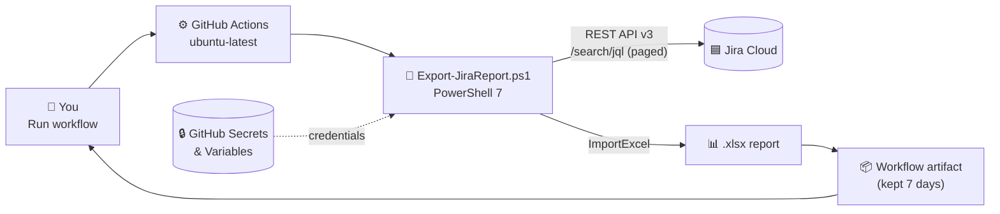

<div align="center">

# 📊 Jira → Excel Reports with GitHub Actions

**One click in GitHub Actions turns any Jira Cloud project into a color-coded Excel report: no server, no local setup.**

[](https://github.com/21bshwjt/GHActions_JIRA/actions/workflows/jira-report.yml)


[](https://github.com/21bshwjt/GHActions_JIRA/stargazers)
[](https://github.com/21bshwjt/GHActions_JIRA/commits/main)

[What you get](#-what-you-get) •
[Quick start](#-quick-start) •
[Architecture](#-architecture) •
[Run locally](#-run-it-locally) •
[Security](#-security)

</div>

---

## 💡 Why this repo?

Teams spend time exporting Jira issues by hand, then cleaning them up in Excel to answer the same questions every sprint. This repo automates that with a **GitHub Actions workflow** and a **PowerShell script**.

- ✅ **One-click reports:** run the workflow, download the `.xlsx`
- ✅ **Spot gaps fast:** flags tickets with no **Description** or **Acceptance Criteria**
- ✅ **Color-coded status:** Done, In Progress, Blocked and more at a glance
- ✅ **No infrastructure:** runs on GitHub-hosted runners
- ✅ **Secrets stay secret:** the API token lives in GitHub Secrets only
- ✅ **Self-cleaning:** report artifacts are deleted after **7 days**

---

## 📦 What you get

An Excel workbook with **one row per issue**, plus auto-filter, a frozen header and table styling.

| Column | What it shows |
|---|---|
| **Key** · **Summary** · **IssueType** | Basic issue details |
| **Status** | 🟢 Done · 🟡 In Progress · 🔴 Blocked · ⚪ To Do / Backlog · 🔵 On Hold |
| **Assignee** | Who owns it |
| **Labels** | All labels, comma-separated |
| **StartDate** · **DueDate** | Planning dates |
| **Description** | 🟢 `True` if filled in · 🔴 `False` if empty |
| **AcceptanceCriteria** | 🟢 `True` if filled in · 🔴 `False` if empty |

---

## 🚀 Quick start

1. **Fork** this repository.
2. **Create a Jira API token** at [id.atlassian.com → Security → API tokens](https://id.atlassian.com/manage-profile/security/api-tokens).
3. Go to **Settings → Secrets and variables → Actions** in your fork and add:

   | Type | Name | Example |
   |---|---|---|
   | 🔧 Variable | `JIRA_BASE_URL` | `https://your-site.atlassian.net` |
   | 🔧 Variable | `JIRA_EMAIL` | `you@example.com` |
   | 🔒 Secret | `JIRA_API_TOKEN` | *(your API token)* |

4. Open **Actions → Jira Report → Run workflow**, enter your **project key** (default `KAN`) and run it.
5. When it finishes, download the **`jira-report`** artifact from the run summary. 🎉

> [!IMPORTANT]
> **Custom field IDs differ on every Jira site.** The defaults are `customfield_10015` (Start date) and `customfield_10320` (Acceptance criteria).
> To find yours, open `https://your-site.atlassian.net/rest/api/3/field` in a browser while signed in and search for the field name. Then update the defaults in [`Export-JiraReport.ps1`](Export-JiraReport.ps1).

---

## 🏗️ Architecture



**How it works**

1. You trigger the workflow manually (`workflow_dispatch`) with a project key.
2. The script reads the Jira credentials from GitHub Secrets and Variables.
3. It calls the Jira Cloud **REST API v3**, following `nextPageToken` until every issue is fetched.
4. Each issue becomes one row, with `True`/`False` flags for Description and Acceptance Criteria.
5. **ImportExcel** writes the styled workbook, and the workflow uploads it as an artifact.

---

## 💻 Run it locally

Requires **PowerShell 7+**. The [ImportExcel](https://github.com/dfinke/ImportExcel) module installs automatically on first run. Microsoft Excel is **not** needed to generate the report.

```powershell
$env:JIRA_BASE_URL  = 'https://your-site.atlassian.net'
$env:JIRA_EMAIL     = 'you@example.com'
$env:JIRA_API_TOKEN = Read-Host 'Jira API token'

./Export-JiraReport.ps1 -ProjectKey KAN -OutputFolder ./reports
```

<details>
<summary><b>All parameters</b></summary>

| Parameter | Default | Purpose |
|---|---|---|
| `-ProjectKey` | `KAN` | Jira project to export |
| `-OutputFolder` | `D:\Reports` | Where the workbook is saved |
| `-ExcelFileName` | `JIRA_Report_All.xlsx` | Output file name |
| `-WorksheetName` | `All_Issues` | Sheet name |
| `-StartDateFieldId` | `customfield_10015` | Start date custom field |
| `-AcceptanceCriteriaFieldId` | `customfield_10320` | Acceptance criteria custom field |
| `-JiraBaseUrl` · `-Email` · `-ApiToken` | `JIRA_*` environment variables | Jira connection |

</details>

---

## 🔐 Security

- 🔒 The API token is stored only as a **GitHub Secret**. It never appears in the repo, the logs or the report.
- 👤 The token acts as your Jira account, so use an account that only needs **Browse** access to the project.
- 🗑️ Report artifacts are **automatically deleted after 7 days**.

---

## 📁 Project structure

```
GHActions_JIRA/
├── .github/workflows/
│   └── jira-report.yml      # Manual workflow: runs the script, uploads the report
├── Export-JiraReport.ps1    # Fetches issues from Jira and builds the Excel file
└── README.md
```

---

## 🧰 Tech stack

**PowerShell 7** · **Jira Cloud REST API v3** · **[ImportExcel](https://github.com/dfinke/ImportExcel)** · **GitHub Actions**

---

<div align="center">

⭐ **If this saved you time, give the repo a star!** ⭐

Questions or ideas? [Open an issue](https://github.com/21bshwjt/GHActions_JIRA/issues) or send a pull request.

</div>
