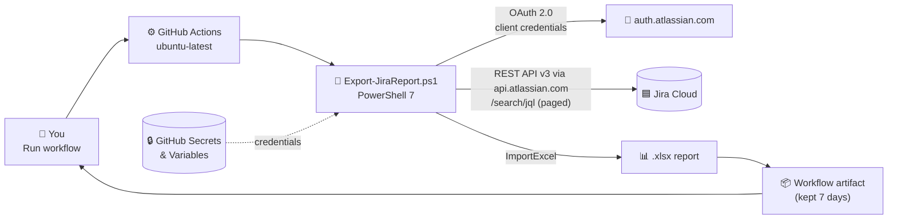

<div align="center">

# 📊 Jira → Excel Reports with GitHub Actions

**One click in GitHub Actions turns any Jira Cloud project into a color-coded Excel report: no server, no local setup.**

[](https://github.com/21bshwjt/GHActions_JIRA/actions/workflows/jira-report.yml)


[](https://github.com/21bshwjt/GHActions_JIRA/stargazers)
[](https://github.com/21bshwjt/GHActions_JIRA/commits/main)

[What you get](#-what-you-get) •
[Quick start](#-quick-start) •
[Setup guide](#-setup-guide-service-account--client-id) •
[Architecture](#-architecture) •
[Run locally](#-run-it-locally) •
[Security](#-security)

</div>

---

## 💡 Why this repo?

Teams spend time exporting Jira issues by hand, then cleaning them up in Excel to answer the same questions every sprint. This repo automates that with a **GitHub Actions workflow** and a **PowerShell script**.

- ✅ **One-click reports:** run the workflow, download the `.xlsx`
- ✅ **Spot gaps fast:** flags tickets with no **Description** or **Acceptance Criteria**
- ✅ **Color-coded status:** Done, In Progress, Blocked and more at a glance
- ✅ **No infrastructure:** runs on GitHub-hosted runners
- ✅ **Service account auth:** OAuth 2.0 client credentials, not a personal API token
- ✅ **Self-cleaning:** report artifacts are deleted after **7 days**

---

## 📦 What you get

An Excel workbook with **one row per issue**, plus auto-filter, a frozen header and table styling.

| Column | What it shows |
|---|---|
| **Key** · **Summary** · **IssueType** | Basic issue details |
| **Status** | 🟢 Done · 🟡 In Progress · 🔴 Blocked · ⚪ To Do / Backlog · 🔵 On Hold |
| **Assignee** | Who owns it |
| **Labels** | All labels, comma-separated |
| **StartDate** · **DueDate** | Planning dates |
| **Description** | 🟢 `True` if filled in · 🔴 `False` if empty |
| **AcceptanceCriteria** | 🟢 `True` if filled in · 🔴 `False` if empty |

---

## 🚀 Quick start

1. **Fork** this repository.
2. **Create an Atlassian service account and its Client ID / Client secret.** Follow the [step-by-step setup guide](#-setup-guide-service-account--client-id) below.
3. **Find your Cloud ID.** See [Step 5 of the guide](#step-5--find-your-cloud-id).
4. Go to **Settings → Secrets and variables → Actions** in your fork and add:

   | Type | Name | Example |
   |---|---|---|
   | 🔧 Variable | `JIRA_CLOUD_ID` | `a1b2c3d4-...` |
   | 🔒 Secret | `JIRA_CLIENT_ID` | *(service account Client ID)* |
   | 🔒 Secret | `JIRA_CLIENT_SECRET` | *(service account Client secret)* |

5. Open **Actions → Jira Report → Run workflow**, enter your **project key** (default `KAN`) and run it.
6. When it finishes, download the **`jira-report`** artifact from the run summary. 🎉

> [!IMPORTANT]
> **Custom field IDs differ on every Jira site.** The defaults are `customfield_10015` (Start date) and `customfield_10320` (Acceptance criteria).
> To find yours, open `https://your-site.atlassian.net/rest/api/3/field` in a browser while signed in and search for the field name. Then update the defaults in [`Export-JiraReport.ps1`](Export-JiraReport.ps1).

---

## 🔑 Setup guide: service account & Client ID

The workflow signs in to Jira as an **Atlassian service account** using **OAuth 2.0 client credentials** (a Client ID and Client secret).

> [!WARNING]
> **Don't use a personal account or a personal API token in GitHub Actions.** A personal token can do everything you can do in Jira, stops working when you leave or your account is disabled, and records every action as you.
> A service account has only the access you give it and doesn't depend on any one person.

### ✅ Before you start: access you need

| Who / what | Why it's needed |
|---|---|
| 🛡️ **Organization admin** in [Atlassian Administration](https://admin.atlassian.com) | Only organization admins can create service accounts and their credentials |
| 💳 **Atlassian Guard Standard or Enterprise** subscription | Service accounts are a Guard feature. Guard Standard allows up to 250 and Enterprise up to 1,000 ([Atlassian docs](https://support.atlassian.com/user-management/docs/understand-service-accounts/)) |
| 🧭 **Centralized user management** experience in your org | The **Service accounts** page only appears in this experience |
| 🟦 **Jira admin** or **project admin** on the project you want to report on | To give the service account permission to read the project |
| 🐙 **Admin** on the GitHub repository | To add Actions secrets and variables |

If you're not an organization admin, send Steps 1–4 to your Atlassian admin. Ask them to send back the **Client ID** and **Client secret** through a secure channel such as a password manager, not email or chat.

### Step 1 · Create the service account

1. Go to [admin.atlassian.com](https://admin.atlassian.com) and select your organization if you have more than one.
2. Select **Directory** → **Service accounts**.
3. Select **Create a service account**.
4. **Name:** 6–30 letters and numbers, for example `jirareportbot`.
5. **Description** (optional): say who owns it and what it's for, for example *"GitHub Actions – Jira Excel report. Owner: Platform team"*.
6. **App access:** choose a **user** role for your **Jira** site. Don't give it an admin role.
7. Select **Create**.

### Step 2 · Create the OAuth 2.0 credential (Client ID + secret)

1. In **Directory** → **Service accounts**, select the account you just created.
2. Select **Create credentials**.
3. Choose **OAuth 2.0** and select **Next**.
4. **Select scopes:** pick read-only Jira scopes. This report only reads data:

   | Scope | Why |
   |---|---|
   | `read:jira-work` | Search issues and read their fields (classic scope, recommended if offered) |
   | `read:jira-user` | Read the assignee's display name |

   If only *granular* scopes are offered, select the read-only Jira scopes for **issues**, **issue details**, **fields**, **JQL / search** and **users**. Never select write or admin scopes.
5. Select **Next**, review, then select **Create**.
6. **Copy the Client ID and Client secret right away and store them in a password manager.**

> [!CAUTION]
> The Client secret is shown **only once**. You can't view it again, and you can't view the credential's scopes later either. If you lose the secret, revoke the credential and create a new one.

### Step 3 · Give the service account access to your Jira project

Having access to the Jira app isn't enough. The account also needs **Browse projects** permission on the project you report on.

1. In Jira, open the project and go to **Project settings** → **People** (or **Access**).
2. Select **Add people**, search for the service account by name, and give it a role that can browse the project, such as **Viewer** or **Member**.
3. If your company uses permission schemes, check that this role or the account's group has **Browse projects** in **Project settings** → **Permissions**.

> [!TIP]
> If the workflow succeeds but the report is **empty**, the service account almost certainly can't see the project. Re-check this step.

### Step 4 · (Optional) Test the credential from your PC

```powershell
$body  = @{ grant_type = 'client_credentials'; client_id = '<client-id>'; client_secret = '<client-secret>' }
$token = Invoke-RestMethod -Method Post -Uri 'https://auth.atlassian.com/oauth/token' `
           -ContentType 'application/x-www-form-urlencoded' -Body $body
$token.expires_in   # 3600 = success
```

A `401` or `invalid_client` error means the Client ID or Client secret is wrong.

### Step 5 · Find your Cloud ID

The **Cloud ID** (also called **tenant ID** or **site ID**) is a GUID that identifies your Jira site, for example `a1b2c3d4-e5f6-7890-abcd-ef1234567890`. Use any one of these methods:

| Method | How |
|---|---|
| 🌐 **Browser (easiest)** | Open `https://<your-site>.atlassian.net/_edge/tenant_info`. You'll see `{"cloudId":"..."}` |
| 💻 **PowerShell** | `(Invoke-RestMethod 'https://<your-site>.atlassian.net/_edge/tenant_info').cloudId` |
| 🐧 **curl** | `curl -s https://<your-site>.atlassian.net/_edge/tenant_info` |

Replace `<your-site>` with your Jira subdomain, for example `contoso` for `contoso.atlassian.net`. You don't need to sign in.

### Step 6 · Add them to GitHub

In your repo, go to **Settings** → **Secrets and variables** → **Actions** and add **3 entries**:

| Tab | Name | Value |
|---|---|---|
| **Variables** | `JIRA_CLOUD_ID` | Cloud ID from Step 5 |
| **Secrets** | `JIRA_CLIENT_ID` | Client ID from Step 2 |
| **Secrets** | `JIRA_CLIENT_SECRET` | Client secret from Step 2 |

`JIRA_BASE_URL`, `JIRA_EMAIL` and `JIRA_API_TOKEN` are **not** needed. The Cloud ID already tells Atlassian which site to use.

### 🔄 Rotating or revoking the credential

- **Revoke:** **Directory** → **Service accounts** → select the account → **Credentials** → **Revoke**. A revoked credential stops working immediately.
- **Rotate:** create a new credential (Step 2), update `JIRA_CLIENT_ID` and `JIRA_CLIENT_SECRET` in GitHub, run the workflow once to confirm it works, then revoke the old credential.
- Rotate right away if the secret is ever exposed.

### 🩺 Troubleshooting

| Symptom | Likely cause | Fix |
|---|---|---|
| `Failed to get OAuth access token` · `401` / `invalid_client` | Wrong Client ID or secret, or the credential was revoked | Re-check the GitHub secrets, or create a new credential |
| `401` / `403` on the issue search | A scope is missing, or the account has no Jira access | Re-create the credential with the scopes in Step 2, and check the Jira user role from Step 1 |
| `404` on the issue search | Wrong `JIRA_CLOUD_ID` | Repeat Step 5 |
| Workflow succeeds but the report is empty | The service account can't see the project | Step 3 |
| `CloudId is required…` | `JIRA_CLOUD_ID` was added as a **secret** instead of a **variable**, or not added at all | Add it under the **Variables** tab |

---

## 🏗️ Architecture



**How it works**

1. You trigger the workflow manually (`workflow_dispatch`) with a project key.
2. The script exchanges the service account's Client ID and secret for an OAuth access token.
3. It calls the Jira Cloud **REST API v3** through `api.atlassian.com/ex/jira/{cloudId}`, following `nextPageToken` until every issue is fetched.
4. Each issue becomes one row, with `True`/`False` flags for Description and Acceptance Criteria.
5. **ImportExcel** writes the styled workbook, and the workflow uploads it as an artifact.

---

## 💻 Run it locally

Requires **PowerShell 7+**. The [ImportExcel](https://github.com/dfinke/ImportExcel) module installs automatically on first run. Microsoft Excel is **not** needed to generate the report.

```powershell
$env:JIRA_CLOUD_ID      = '<your-cloud-id>'
$env:JIRA_CLIENT_ID     = '<your-client-id>'
$env:JIRA_CLIENT_SECRET = Read-Host 'Client secret'

./Export-JiraReport.ps1 -ProjectKey KAN -OutputFolder ./reports
```

<details>
<summary><b>All parameters</b></summary>

| Parameter | Default | Purpose |
|---|---|---|
| `-ProjectKey` | `KAN` | Jira project to export |
| `-OutputFolder` | `D:\Reports` | Where the workbook is saved |
| `-ExcelFileName` | `JIRA_Report_All.xlsx` | Output file name |
| `-WorksheetName` | `All_Issues` | Sheet name |
| `-StartDateFieldId` | `customfield_10015` | Start date custom field |
| `-AcceptanceCriteriaFieldId` | `customfield_10320` | Acceptance criteria custom field |
| `-CloudId` · `-ClientId` · `-ClientSecret` | `JIRA_CLOUD_ID` · `JIRA_CLIENT_ID` · `JIRA_CLIENT_SECRET` | OAuth 2.0 service account (preferred) |
| `-JiraBaseUrl` · `-Email` · `-ApiToken` | `JIRA_BASE_URL` · `JIRA_EMAIL` · `JIRA_API_TOKEN` | Fallback for **local runs only**: basic auth with a personal API token. Don't use it in GitHub Actions. |

</details>

---

## 🔐 Security

- 🔒 The Client ID and secret are stored only as **GitHub Secrets**. They never appear in the repo, the logs or the report.
- 🤖 A **service account** is used instead of a personal account, so access is limited to the `read:jira-work` scope and the projects you grant it.
- ⏱️ Each run exchanges the credentials for an access token that expires after **1 hour**.
- 🗑️ Report artifacts are **automatically deleted after 7 days**.

---

## 📁 Project structure

```
GHActions_JIRA/
├── .github/workflows/
│   └── jira-report.yml      # Manual workflow: runs the script, uploads the report
├── Export-JiraReport.ps1    # Fetches issues from Jira and builds the Excel file
└── README.md
```

---

## 🧰 Tech stack

**PowerShell 7** · **Jira Cloud REST API v3** · **[ImportExcel](https://github.com/dfinke/ImportExcel)** · **GitHub Actions**

---

<div align="center">

⭐ **If this saved you time, give the repo a star!** ⭐

Questions or ideas? [Open an issue](https://github.com/21bshwjt/GHActions_JIRA/issues) or send a pull request.

</div>
